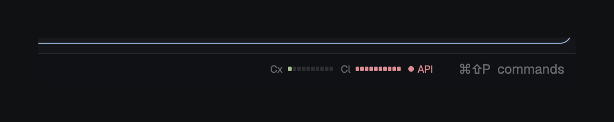

# Herdr Account Usage



A Herdr layout add-on that puts Codex and Claude consumption meters in the bottom-right status bar. Click the meters to open detailed session and weekly usage, reset times, pace projections, and a Claude Subscription/API billing toggle.

## Requirements

- Herdr app 0.1.16 or newer
- Node.js 22 or newer
- Signed-in Codex and/or Claude CLI accounts

## Install

Copy the two mods and layout into your Herdr app home:

```sh
cp -R mods/account-usage ~/.config/herdr-app/mods/
cp -R mods/workspace-status-usage ~/.config/herdr-app/mods/
cp layouts/main-usage.json ~/.config/herdr-app/layouts/
```

Merge the shortcut from [`keys.json`](keys.json) into your own `~/.config/herdr-app/keys.json`. Do not replace your whole keys file.

Then validate and switch layouts:

```sh
herdr-app check ~/.config/herdr-app/mods/account-usage
herdr-app check ~/.config/herdr-app/mods/workspace-status-usage
herdr-app do layout.switch --name main-usage
```

If `main-usage` already exists, rename the layout file, its layout name when switching, and any colliding mod folders or references before copying.

## Use it in another layout

The included `main-usage` layout is a clone of Herdr's main layout with its status block changed to:

```json
{
  "id": "status",
  "type": "block",
  "content": { "mod": "workspace-status-usage" },
  "size": { "px": 28 }
}
```

Use the same block in a personal layout if you do not want the included clone.

## Privacy and security

This mod runs local Node.js helpers and calls:

- `https://chatgpt.com/backend-api/wham/usage`
- `https://api.anthropic.com/api/oauth/usage`

It reads the credentials already used by the Codex and Claude CLIs. Tokens and credential paths remain in memory and are never printed or stored by the mod. Local `cache.json` and `history.json` files contain only sanitized usage windows and timestamps and are ignored by Git.

The Claude billing toggle edits `~/.claude/settings.json` only after a click. It moves the existing `ANTHROPIC_BASE_URL` and `ANTHROPIC_AUTH_TOKEN` pair between active and underscore-prefixed parked fields. It refuses incomplete or conflicting configurations.

## Development

```sh
npm test
herdr-app check ./mods/account-usage
herdr-app check ./mods/workspace-status-usage
```

Validated with Herdr app 0.1.16. See [`RECIPE.md`](RECIPE.md) for the implementation brief.

## License

MIT
