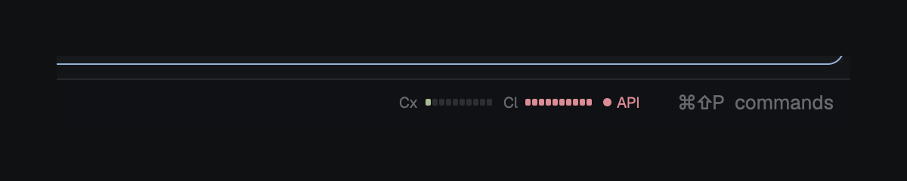

# Herdr Account Usage

A compact Codex and Claude consumption map in Herdr's bottom-right status bar, with a detailed account popup and a Claude Subscription/API billing switch.

## What you see

The status bar ends with one small combined control. `Cx` and `Cl` each have ten 3×4px usage segments. Filled segments are green below 70%, amber from 70%, and red from 90%. The Claude billing mode follows the meters: `Sub` in the done color, or `API` in muted text. When API billing is active while Claude subscription capacity is available, `API` turns red and gets a 5px red dot.

Clicking the control opens a centered 620×400 themed popup. Its header says “Accounts” and has the last check time, refresh, and close controls. Codex and Claude cards show available Session and Week meters, percentages, reset timing, and—after enough history exists—a comparison with the prior cycle and a pace projection. The Claude card also has a compact `Sub` / `API` toggle.

## How it behaves

The status map refreshes usage when it starts and every five minutes. It keeps the last successful values when a provider is unavailable. Clicking it runs `mod.open` for `account-usage`. `Cmd+Shift+U`, when merged from `keys.json`, opens the same popup.

The popup hydrates from shared cached state, refreshes stale data on open, refreshes every five minutes while visible, and refreshes immediately when the user clicks ↻ or presses `R`. Escape or × closes it. Missing accounts and provider failures stay local to their card.

The Claude toggle changes only newly started Claude sessions. It moves an existing `ANTHROPIC_BASE_URL` and `ANTHROPIC_AUTH_TOKEN` pair between active fields and underscore-prefixed parked fields. It refuses to write when the pair is incomplete, conflicting, or changed since it was read.

## Built from

- `layouts/main-usage.json` is a personal clone of Herdr's `main` layout. Its 28px bottom status block uses `workspace-status-usage`.
- `mods/workspace-status-usage/main.js` retains the shipped workspace status information and adds the usage control on the right. It uses `shared`, `setShared`, `exec`, `appHome`, `theme`, `spaces`, `agents`, `keys`, `window`, and `run` from `herdr`.
- `mods/account-usage/main.js` renders the popup with GPUI `div`, `h_flex`, and `v_flex` elements. It uses Herdr's overlay, file, process, shared-state, home, and theme APIs.
- `usage-helper.mjs` reads the existing Codex and Claude CLI credentials in memory, fetches provider usage, writes sanitized cache and history files atomically with mode `0600`, and emits JSON for the mods.
- `usage-pace.mjs` records at most one stable sample per ten minutes, retains nine days, compares against the same point in the prior cycle, detects resets, and projects whether the current burn rate will last until reset.
- `claude-auth.mjs` inspects and safely rewrites the existing Claude settings field pair after an explicit toggle.
- The popup uses Herdr's shipped `icons/codex.svg` and `icons/claude.svg`. The status bar uses icons from the shipped `workspace-chrome` mod.

## Watch out

The mod reaches the network, runs local Node.js, reads CLI credentials, and can edit `~/.claude/settings.json` after an explicit billing-toggle click. It never prints or persists tokens or credential paths.

Codex usage comes from `https://chatgpt.com/backend-api/wham/usage`. Claude usage comes from `https://api.anthropic.com/api/oauth/usage`. These are provider endpoints used by the installed CLI sessions and may change.

On macOS, Claude credentials are read from the matching Keychain service. On other systems, the helper reads `.credentials.json` from `CLAUDE_CONFIG_DIR` or `~/.claude`. Account discovery honors `CODEX_HOME` and `CLAUDE_CONFIG_DIR`.

The billing toggle expects both Claude API fields to be either active or parked. It deliberately does nothing for incomplete or conflicting settings. The layout was cloned from Herdr main 0.1.12 and validated on Herdr app 0.1.16; a later main layout may add structure that this clone does not inherit.

`cache.json` and `history.json` are runtime files. Do not distribute a user's copies.

## Done when

- `node --test mods/account-usage/*.test.mjs` passes.
- `herdr-app check ~/.config/herdr-app/mods/account-usage` passes.
- `herdr-app check ~/.config/herdr-app/mods/workspace-status-usage` passes.
- `herdr-app status` reports no new errors.
- The `main-usage` layout shows `Cx`, `Cl`, and the Claude billing mode at bottom right.
- Clicking the map opens the Accounts popup.
- Live percentages render for signed-in accounts without credentials appearing in stdout, `shared.json`, `cache.json`, or `history.json`.
- A billing-mode change updates only the expected Claude settings fields and applies to a newly started Claude session.
